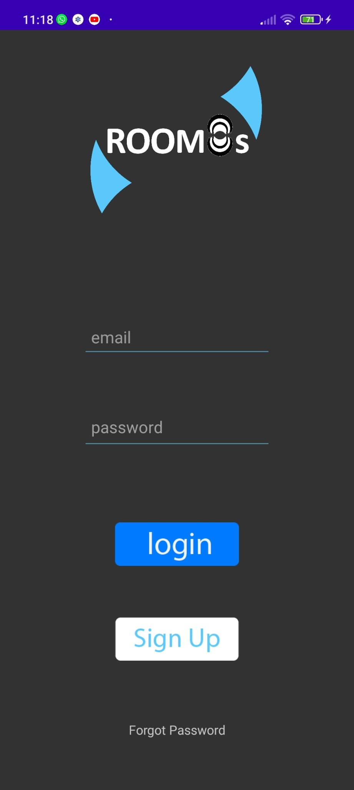
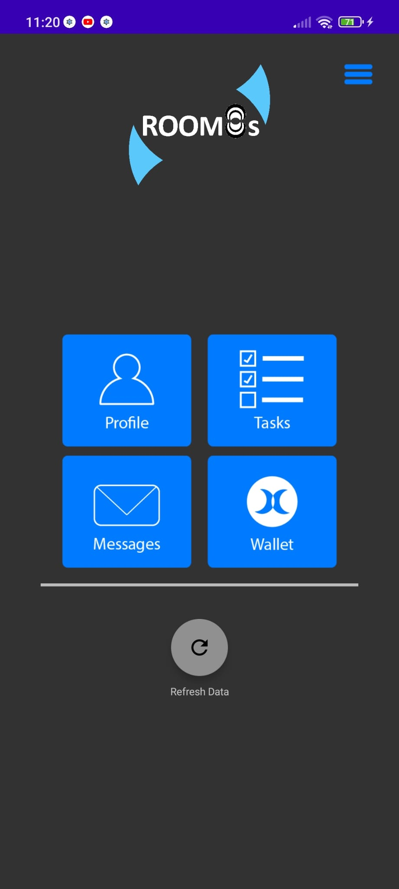
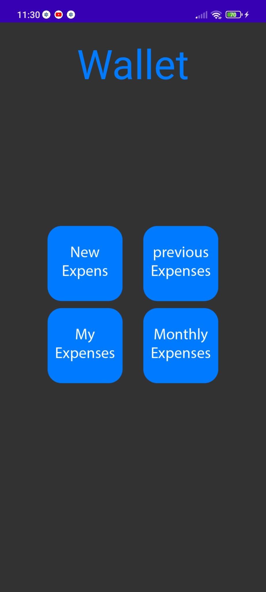
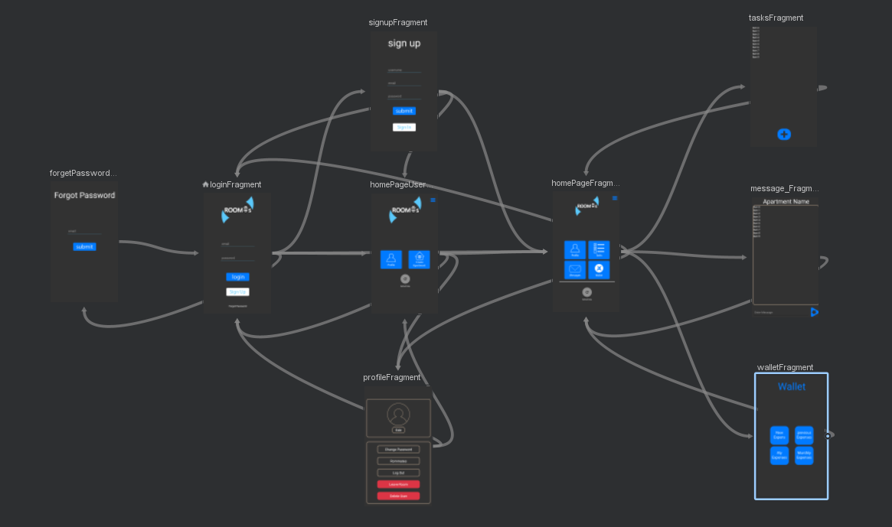

# Room8s  
*A social network for roommates to keep bills, chores, and chats in one place*

---

## Overview  
Room8s makes shared living simpler:

* **Track shared expenses** – log who paid for what and settle up instantly.  
* **Manage household tasks** – create to-dos, assign roommates, and set reminders.  
* **Real‑time group chat** – coordinate plans or just hang out in the app.  
* **Mobile first** – native Android client backed by a REST/Socket‑powered API.

---

## Technologies Used  
| Layer | Tech stack |
|-------|------------|
| **Mobile app** | Android 11, Java 17, Android Jetpack |
| **Backend API** | Node.js 18, Express, Socket.io |
| **Database** | MySQL 8, Sequelize ORM |
| **Tooling & Ops** | JWT auth, dotenv, ESLint / Prettier, GitHub Actions CI |

---

## Installation

> **Prerequisites**  
> * JDK 17+ and Android Studio Giraffe (or newer)  
> * Node.js 18+ and npm 9+  
> * MySQL 8 server

1. **Clone the repo**

   ```bash
   git clone https://github.com/ShayGali/Room8s.git
   cd Room8s
   ```

2. **Set up the database**

   ```bash
   mysql -u <user> -p < database/room8s_schema.sql
   ```

   Create a `.env` file inside `back/` with your credentials:

   ```
   DB_HOST=localhost
   DB_USER=<user>
   DB_PASS=<password>
   DB_NAME=room8s
   JWT_SECRET=change_me
   ```

3. **Start the backend**

   ```bash
   cd back
   npm install
   npm start          # default: http://localhost:4000
   ```

4. **Run the Android app**

   ```bash
   cd ../front
   # Open with Android Studio → “Run” on a device/emulator
   ```

---

## Usage  

| Feature | Screenshot |
|---------|------------|
| **Login / Sign-up**     |  |
| **Home screen**         |  |
| **Expense splitter**    |  |
| **Group chat**          |  |
| **Screen diagram**      |  |

> _More screens are available in the app – only a subset is shown here._

